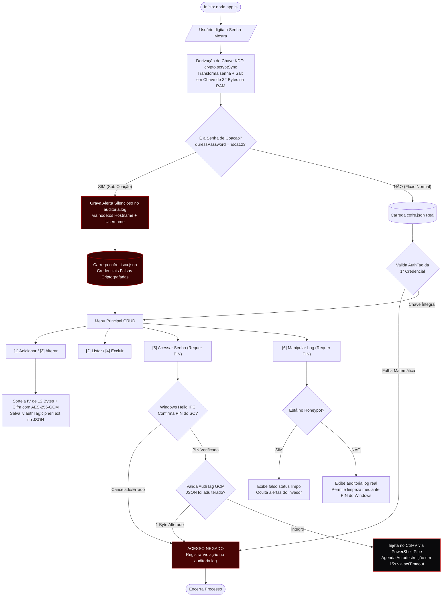

# HoneyGuard — CLI Password manager

<p>
  
  
  
  
</p>

Gerenciador de senhas via terminal (**CLI**) desenvolvido em **Node.js** utilizando exclusivamente módulos nativos da plataforma (`node:crypto`, `node:fs/promises`, `node:os`, `node:child_process` e `node:readline/promises`)

<br clear="left"/>

O projeto implementa criptografia autenticada (**AES-256-GCM**), integração nativa com biometria/PIN do Sistema Operacional (**Windows Hello**), área de transferência com autodestruição (*TTL Clipboard*), auditoria forense persistente e um sistema de **Cofre Isca (*Honeypot* / Senha de Coação)**.

> **Status do Projeto:** Em evolução contínua. Este `README` documenta a versão inicial da arquitetura, cujo objetivo central é aprimorar o código até consolidar uma aplicação completa e funcional para distribuição.

## Fluxograma de Arquitetura e Segurança



## Demonstração Prática (Passo a Passo em Vídeo)

### 1. Ciclo CRUD Completo e Persistência Criptografada (`AES-256-GCM`)
Demonstração das operações de criação (`[1]`), listagem (`[2]`), atualização (`[3]`) e exclusão (`[4]`). A cada operação em memória, o arquivo `cofre.json` é atualizado em tempo real no disco utilizando um *Initialization Vector* (`IV`) aleatório de 12 bytes e selo de integridade `authTag`.

https://github.com/user-attachments/assets/bb43b0f6-799e-4803-9a26-70c66ff90488

---

### 2. Validação da Senha-Mestra

A Senha-Mestra jamais é salva no código ou no disco. Ao iniciar uma sessão em um cofre existente, o sistema deriva os 32 bytes na memória RAM via `scryptSync` e testa a autenticidade matemática (`authTag`) da primeira credencial armazenada. Chaves incorretas são bloqueadas imediatamente na entrada e registradas na auditoria.

https://github.com/user-attachments/assets/e8e81d2f-4ec1-43ab-8db7-ebe8e6a4754f

---

### 3. Autenticação Windows Hello (PIN) e Clipboard Autodestrutivo (`Ctrl + V`)
Mesmo com o cofre aberto, o acesso a uma senha (`[5]`) exige confirmação presencial via API nativa do Windows (`UserConsentVerifier`). Após a validação do PIN, a senha não é exibida na tela: ela é injetada via *pipe* direto na área de transferência do sistema e apagada automaticamente após **15 segundos** (`setTimeout` assíncrono).

https://github.com/user-attachments/assets/38c3af6d-f429-4bf1-b939-81655f0fabe7

---

### 4. Auditoria (`node:os`), Falha de PIN e Persistência de Logs
Qualquer tentativa de cancelar/errar o PIN do Windows ou adulterar 1 único byte do arquivo `cofre.json` aciona o motor forense, que coleta data/hora, nome da máquina na rede (`os.hostname()`) e usuário do sistema (`os.userInfo().username`), gravando o incidente no arquivo `auditoria.log`. A limpeza do histórico (`[6]`) também exige confirmação biométrica/PIN.

https://github.com/user-attachments/assets/920fb8a4-3755-4813-ab6e-5e346644fffd

---

### 5. Defesa Ativa: Cofre Isca (*Honeypot* / Senha de Coação)
Caso o usuário seja coagido a destrancar o sistema e digite a senha secundária de coação (`isca123`), o gerenciador simula uma inicialização normal, carrega um banco de dados paralelo (`cofre_isca.json`) com credenciais falsas, oculta os alertas na visualização do terminal e grava silenciosamente um alerta crítico de coação no arquivo `auditoria.log`.

https://github.com/user-attachments/assets/f6352c1d-1caa-4c49-a441-6387be076fb5

---

## Resumo da Arquitetura de Segurança

| Camada de Proteção | Implementação Técnica no Código | Ameaça Mitigada |
| :--- | :--- | :--- |
| **KDF (*Key Derivation Function*)** | `crypto.scryptSync(masterPassword, vaultSalt, 32)` | Vazamento de senha-mestra em disco e ataques de dicionário. |
| **Criptografia Simétrica Autenticada** | `AES-256-GCM` com `IV` de 12 bytes + `authTag` (16 bytes) | Leitura não autorizada do `.json` e adulteração física de bytes (*Tampering*). |
| **2FA Nativo do Sistema Operacional** | `Windows.Security.Credentials.UI.UserConsentVerifier` | Acesso por terceiros em terminal aberto/desbloqueado. |
| **Clipboard** | `Set-Clipboard` via `stdin pipe` + `setTimeout(..., 15000)` | *Shoulder Surfing* (espionagem visual) e roubo de histórico do `Ctrl + V`. |
| **Tecnologia de Engano (*Deception*)** | Isolamento de estado em `cofre_isca.json` (*Honeypot*) | Extorsão ou coação física contra o proprietário do cofre. |
| **Rastreabilidade (SIEM Local)** | Coleta via `os.hostname()` + `os.userInfo().username` | Tentativas de força bruta ou negação de autoria em ataques locais. |

---

## Estrutura Modular do Projeto

* **`app.js`**: Camada de interface em linha de comando (CLI), validação de entradas obrigatórias, controle de fluxo assíncrono (`async/await`) e manipulação de estruturas de dados em memória (`.some()`, `.find()`, `.findIndex()`, `.splice()`).
* **`security.js`**: Camada de segurança e sistema operacional. Responsável pela derivação de chaves, cifragem/decifragem `AES-256-GCM`, comunicação com processos filhos do PowerShell (`node:child_process`), persistência em arquivos JSON (`node:fs/promises`) e auditoria forense (`node:os`).

---

## Como Executar Localmente

Pré-requisitos: **Node.js** (v18 ou superior) em ambiente **Windows 10/11** com Windows Hello configurado.

```bash
# 1. Clone o repositório
git clone [https://github.com/SEU-USUARIO/gerenciador-de-senhas.git](https://github.com/SEU-USUARIO/gerenciador-de-senhas.git)

# 2. Acesse o diretório da aplicação
cd gerenciador-de-senhas

# 3. Inicie o gerenciador
node app.js
```
